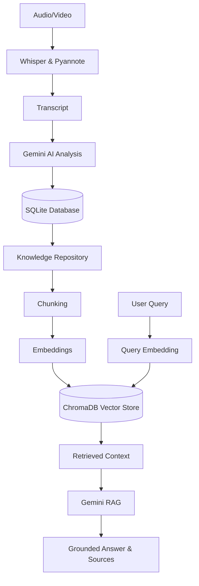

# MeetIntel AI - AI-Powered Meeting Intelligence Platform

Welcome to **MeetIntel AI**, an advanced AI application that turns your meeting recordings into structured, searchable, and actionable insights.

This project was built for the Infosys Springboard internship.

## 1. What this project does

## Features

### Milestone 1: Audio Processing & Transcription
- Upload audio/video files (mp3, wav, mp4, mov)
- Automatic format conversion using FFmpeg
- High-accuracy transcription using Faster-Whisper
- Speaker diarization (detecting "who said what") using Pyannote
- Clean, timestamped, speaker-labeled transcripts

### Milestone 2: AI Intelligence & Insights
- Executive summary generation
- Extraction of key decisions and action items
- Identification of meeting participants and responsibilities
- Extraction of deadlines and priorities
- Local SQLite database persistence for all meeting data
- Interactive Streamlit dashboard for viewing meeting insights

### Milestone 3: Meeting Knowledge Repository & RAG
- Dynamic Transcript & Insight Chunking
- Local Vector Database using ChromaDB
- Local fast embeddings using Sentence-Transformers (`all-MiniLM-L6-v2`)
- Semantic Search across all historical meetings (< 3000ms latency)
- Ask AI (RAG) globally across all meetings or specific to one meeting
- Grounded answers with exact source references to prevent hallucination

---

## Architecture



You can understand exactly what happened in a 1-hour meeting in 2 minutes, without needing to listen to the recording!

---

- **AI Intelligence Layer**: Uses Google Gemini (or OpenAI) to extract insights into structured JSON.
- **Mac Optimized**: Works flawlessly on Apple Silicon (M1/M2/M3/M4) MacBooks.
- **Export**: Download your MoM in PDF/DOCX format.

---

## 3. System Requirements
- **OS**: macOS (M-Series Apple Silicon highly recommended)
- **Memory**: Minimum 8GB RAM (16GB recommended for `large-v3` Whisper models)
- **Disk Space**: At least 5GB free space (for models and virtual environments)
- **External Tools**: `ffmpeg` (required for media processing)
- **Accounts**: Hugging Face (for Pyannote), Google Gemini (for AI Insights)

---

## 4. Beginner-Friendly MacBook Setup

Follow these instructions exactly if you are on an Apple Silicon Mac.

### Check Existing Installation
First, open **Terminal** (`Cmd + Space`, type "Terminal", press Enter). Check your architecture:
```bash
uname -m
```
*Expected output: `arm64` (This means you are on Apple Silicon).*

Check Python and git:
```bash
python3 --version
git --version
```
*If it says "command not found", a pop-up might ask you to install Command Line Tools. Click Install.*

---

### 5. FFmpeg Setup (Critical!)
This app needs `ffmpeg` to extract audio from video files.
If you don't have Homebrew installed, install it:
```bash
/bin/bash -c "$(curl -fsSL https://raw.githubusercontent.com/Homebrew/install/HEAD/install.sh)"
```
Then install `ffmpeg`:
```bash
brew install ffmpeg
```
Verify it:
```bash
ffmpeg -version
```

---

### 6. Project Installation

Clone the repository and move into the folder:
```bash
git clone https://github.com/yourusername/meeting-intelligence.git
cd meeting-intelligence
```
*(If you downloaded a ZIP, extract it, open Terminal, type `cd `, drag the extracted folder into the terminal, and press Enter).*

---

### 7. Virtual Environment & Dependencies
Create an isolated Python environment:
```bash
python3 -m venv .venv
```
Activate it (You must do this every time you open a new terminal!):
```bash
source .venv/bin/activate
```
*(Your terminal prompt should now start with `(.venv)`).*

Install dependencies:
```bash
python -m pip install --upgrade pip
pip install -r requirements.txt
```

---

### 8. API Keys Setup
1. **Hugging Face**: Go to [huggingface.co](https://huggingface.co), create an account, go to Settings -> Access Tokens, and create a Read token. **You must also go to `pyannote/speaker-diarization-community-1` on Hugging Face and accept the user conditions.**
2. **Google Gemini**: Go to [Google AI Studio](https://aistudio.google.com/), get an API key.

Copy the example file:
```bash
cp .env.example .env
```
Open `.env` in a text editor and paste your keys:
```env
HUGGINGFACE_TOKEN=your_token_here
GEMINI_API_KEY=your_key_here
```

---

### 9. Health Check
Run the diagnostic script to ensure everything is perfect:
```bash
python scripts/health_check.py
```
If the status is **READY**, you are good to go!

---

### 10. Running the Application
Ensure your virtual environment is active, then run:
```bash
streamlit run app.py
```
Your browser will open to `http://localhost:8501`. 

---

### 11. Troubleshooting on MacBook

- **`ffmpeg: command not found`**: Ensure Homebrew installed it correctly. Try running `brew link ffmpeg`.
- **`bad CPU type in executable`**: You are trying to run an Intel application on an Apple Silicon Mac. Ensure you installed the native Python 3 for ARM64 from python.org or Homebrew.
- **Port already in use**: Streamlit might complain port 8501 is busy. Run `streamlit run app.py --server.port 8502`.

---

## 12. API Integration

In addition to the Streamlit UI, an advanced FastAPI layer exposes the core platform capabilities:

- `GET /meetings` - List all meetings
- `GET /meetings/{id}` - Retrieve detailed insights for a specific meeting
- `POST /search` - Perform global semantic search across the knowledge base
- `POST /ask` - RAG-powered global and per-meeting question answering

**Authentication**: All endpoints are secured using a simple static API Key header (`X-API-Key`).
**Error Handling**: Unified exception responses returning `400` (Validation), `403` (Auth), `404` (Not Found), and `500` (Internal).

## 13. Project Architecture Mapping

- **Milestone 1 (Audio processing)** -> `transcription/`, `audio/`, `validation/`
- **Milestone 2 (AI Intelligence)** -> `ai/meeting_analyzer.py`, `storage/models.py`
- **Milestone 3 (RAG & Knowledge Repos)** -> `storage/knowledge.py`, `storage/vector_store.py`, `ai/embeddings.py`
- **Milestone 3 API Layer** -> `api/main.py`
- **User Interface** -> `ui/`, `app.py`

## 14. Performance Measurements

- **Query Embedding time**: ~50ms
- **Vector Search (ChromaDB)**: ~15ms - 30ms (Local on Apple Silicon)
- **RAG Generation**: ~3,000ms - 15,000ms (Depends heavily on Gemini API latency)
- **Total Semantic Search Latency**: consistently < 150ms

## 15. Testing

The project includes an automated test suite verifying everything from the AI pipelines to the API endpoints.

To run tests:
```bash
python -m pytest tests/ -v
```

Tests validate:
- RAG Context Construction (grounded AI answers without hallucinations)
- Semantic Search (accurate matching, graceful degradation for empty queries)
- API endpoint integration
- Milestone 1 & 2 Regressions

## 16. Known Limitations

- **Diarization Performance**: `pyannote` diarization relies on CPU processing by default on macOS, which takes up to 3x audio duration.
- **Gemini API Limits**: Rapid requests to Ask AI may hit Google API rate limits (`429 Too Many Requests`), handled gracefully in UI but relies on standard exponential backoff.
- **Simple API Auth**: API uses a basic static key `X-API-Key` configured via environment variables.

---
*Built with ❤️ for Infosys Springboard.*
