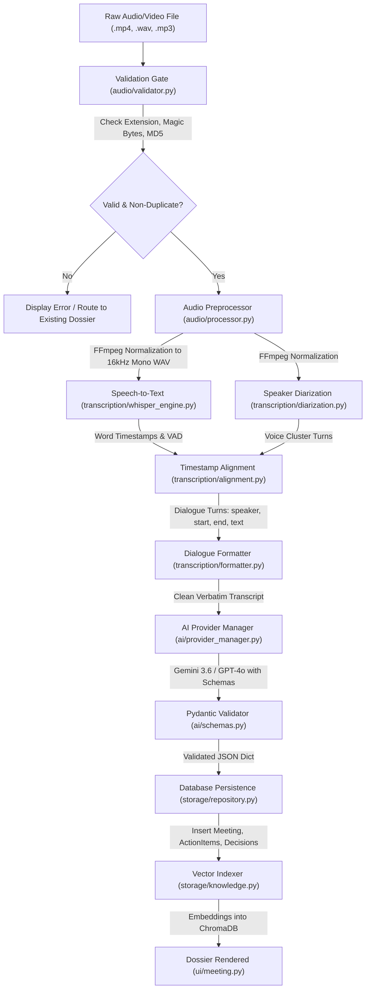
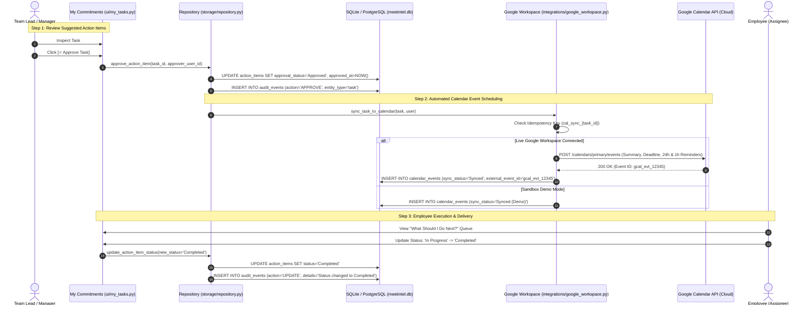
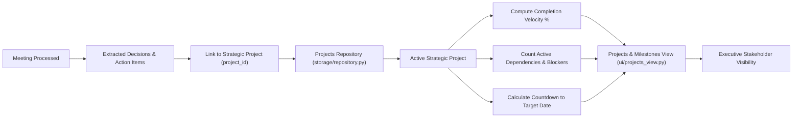
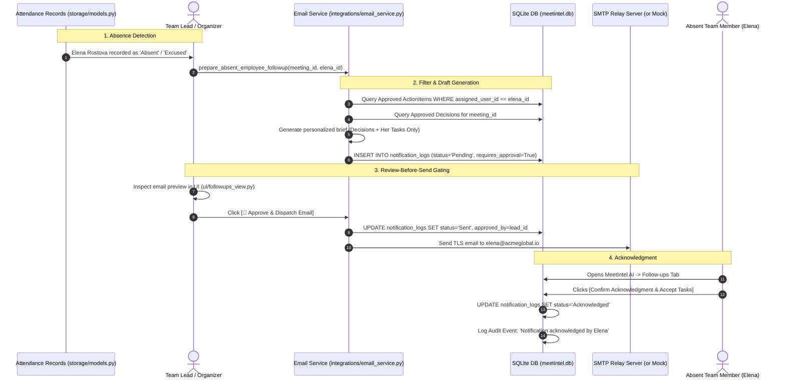

# MeetIntel AI — End-to-End Workflows & Architectural Data Flows

**Document Version:** 2.0.0  
**Scope:** Exhaustive trace of data lifecycles, cross-module communication, synchronous vs. asynchronous execution, and database persistence.

---

## Table of Workflows
1. [Workflow A: Meeting Recording to Actionable Intelligence](#workflow-a-meeting-recording-to-actionable-intelligence)
2. [Workflow B: Action Items to Verified Calendar Execution](#workflow-b-action-items-to-verified-calendar-execution)
3. [Workflow C: Dialogue Ingestion to Semantic Knowledge & RAG](#workflow-c-dialogue-ingestion-to-semantic-knowledge--rag)
4. [Workflow D: Meeting Outcomes to Strategic Project Milestone Tracking](#workflow-d-meeting-outcomes-to-strategic-project-milestone-tracking)
5. [Workflow E: Absentee Follow-up & Review-Before-Send Gating](#workflow-e-absentee-follow-up--review-before-send-gating)

---

# Workflow A: Meeting Recording to Actionable Intelligence



### Detailed Component Trace

#### 1. Ingestion & Validation
- **Trigger:** User uploads a file via `ui/upload.py` or imports from Zoom/Meet.
- **Function:** `audio.validator.validate_file(file_path)` and `audio.validator.get_file_metadata(file_path)`.
- **Deduplication:** `ui.upload.get_file_hash(file_path)` computes an MD5 checksum. `storage.repository.get_meeting_by_hash(db, file_hash)` checks if the file has already been processed. If yes, processing is bypassed to prevent redundant AI spending.
- **Execution Mode:** Synchronous.

#### 2. Media Preprocessing
- **Function:** `audio.processor.process_audio(file_path)`.
- **Implementation:** Executes FFmpeg via subprocess:
  `-vn -acodec pcm_s16le -ar 16000 -ac 1`
- **Output:** Temporary uncompressed 16kHz mono WAV file saved in `data/processed/`.
- **Failure Recovery:** If FFmpeg fails, a descriptive `RuntimeError` is surfaced, and any temporary WAV is safely deleted in a `finally` block.

#### 3. Speech Transcription
- **Function:** `transcription.whisper_engine.WhisperTranscriber.transcribe(processed_wav)`.
- **Implementation:** Initializes CTranslate2 `WhisperModel(model_size_or_path=WHISPER_MODEL, compute_type="int8")`. Runs Silero VAD to prune silent pauses.
- **Output:** List of transcription dictionaries containing `start`, `end`, and `text`.
- **Execution Mode:** Synchronous on local CPU/CUDA.

#### 4. Speaker Diarization
- **Function:** `transcription.diarization.SpeakerDiarizer.diarize(processed_wav)`.
- **Implementation:** Loads `pyannote/speaker-diarization-3.1` using `HUGGINGFACE_TOKEN`. If the token is absent or invalid, it gracefully falls back to an energy-based segmenter rather than halting execution.
- **Output:** Speaker turns: `[{"start": float, "end": float, "speaker": str}]`.

#### 5. Alignment & Formatting
- **Function:** `transcription.alignment.align_transcript_with_speakers(whisper_segments, speaker_segments)`.
- **Implementation:** Computes temporal interval overlap between speech words and speaker segments. Assigns the speaker with maximum temporal intersection.
- **Formatting:** `transcription.formatter.format_transcript()` cleans speech disfluencies.

#### 6. AI Intelligence & Structured Extraction
- **Function:** `ai.meeting_analyzer.MeetingAnalyzer.analyze(text_transcript)`.
- **Implementation:** Passes prompt to `ai.provider_manager.AIProviderManager.generate_insights()`.
  - Attempts Gemini API. If rate-limited (HTTP 429), fails over to OpenAI GPT-4o.
  - Enforces schema compliance via `ai.schemas.MeetingInsightsSchema`.
- **Output:** Validated dictionary containing:
  - `executive_summary`, `meeting_objective`, `emotional_analysis`.
  - `key_topics`, `key_points`, `risks`, `recommendations`, `next_steps`.
  - `action_items` (task, description, assignee, deadline, priority, evidence excerpt, effort).
  - `decisions` (title, decision, context, rationale, alternatives, evidence excerpt).

#### 7. Persistence & Knowledge Indexing
- **Database Insertion:** `ui.meeting.py` executes SQL inserts:
  - `Meeting` row updated with summary and JSON fields.
  - `ActionItem` rows created with initial `status="Pending"` and `approval_status="Draft"`.
  - `Decision` rows created with `status="Approved"`.
  - `Participant`, `Deadline`, `Priority` records persisted.
  - `AuditEvent` logged: `Meeting '{title}' processed`.
- **ChromaDB Indexing:** `storage.knowledge.KnowledgeRepository.index_meeting(meeting.id)` generates 384-dimensional embeddings and inserts chunks into ChromaDB.
- **Cleanup:** Temporary WAV file is unlinked.
- **Result:** User redirected to `Meeting Results` (`ui/insights_view.py`).

---

# Workflow B: Action Items to Verified Calendar Execution



### Key Technical Details
- **Idempotency Guarantee:** If a user clicks **Approve Task** multiple times, `storage.repository.upsert_calendar_event()` checks the unique key `idempotency_key = f"cal_sync_{task.id}"`. If an event already exists, it updates the existing event rather than creating a duplicate on Google Calendar.
- **Role Gate:** If an `Employee` role attempts to call `POST /tasks/{id}/approve`, `api/main.py` raises HTTP 403: *"Employees cannot approve tasks. Requires Team Lead or Admin role."*

---

# Workflow C: Dialogue Ingestion to Semantic Knowledge & RAG

```mermaid
flowchart TD
    A["Raw Dialogue Turns (TranscriptSegment)"] --> B["Dialogue Chunker (ai/embeddings.py)"]
    B -->|Chunk Size: 3-5 Turns with Sliding Overlap| C["Embedding Model (all-MiniLM-L6-v2)"]
    C -->|384-Dimensional Dense Vectors| D["Vector Database (ChromaDB)"]
    
    D -->|Persistent Collection on Disk| E[("storage/vector_db/")]
    
    F["User Question: 'What was decided about the database?'"] --> G["Query Embedding Service"]
    G -->|Query Vector (1x384)| H["Cosine Similarity Search (storage/vector_store.py)"]
    E --> H
    
    H -->|Where: org_id == current_org_id| I["Top-5 Retrieved Context Chunks"]
    I --> J["Grounded Prompt Builder (ai/rag.py)"]
    
    J -->|Strict Grounding System Prompt| K["AI Provider (Gemini / OpenAI)"]
    K -->|Factual Answer + Citation References| L["UI Chat Display (ui/knowledge_search.py)"]
    L --> M["Verifiable Source Chips (Linked to Dialogue)"]
```

### Anti-Hallucination & Tenant Isolation Mechanisms
1. **Tenant Filtering:** In `storage/vector_store.py:search()`, every ChromaDB query includes a mandatory metadata filter: `where={"org_id": org_id}`. An employee in Org A can never retrieve vectors from Org B.
2. **Grounded Instruction:** The prompt enforces:
   *"Answer strictly using only the provided context excerpts. If the information is not present in the excerpts, state that you do not know. Do not speculate."*
3. **Traceable Citations:** Returned chunks include `meeting_title`, `start_time`, and `speakers`, allowing the user to click and verify the exact audio turn.

---

# Workflow D: Meeting Outcomes to Strategic Project Milestone Tracking



### Data Flow
1. Decisions and action items contain an optional `project_id` foreign key.
2. `storage.repository.get_projects()` queries all strategic tracks for the user's organization.
3. For each project, MeetIntel AI dynamically calculates:
   $$\text{Progress \%} = \left( \frac{\text{Completed Tasks}}{\text{Total Linked Tasks}} \right) \times 100$$
4. Active blockers (`status="Blocked"`) are counted to highlight at-risk deliverables.

---

# Workflow E: Absentee Follow-up & Review-Before-Send Gating



### Safety Rules Enforced:
1. **No Cold Automation:** Emails are never dispatched automatically upon meeting completion. A human manager must inspect and click **Approve & Dispatch**.
2. **Approved Items Only:** Unapproved, draft action items are strictly filtered out so an employee is never told to execute an unreviewed task.
3. **Direct Acknowledgment:** The employee's confirmation is written to the immutable audit trail.
