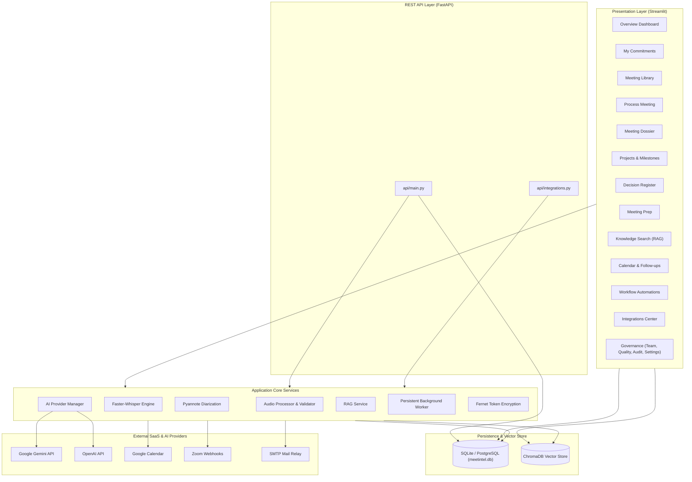

# MeetIntel AI — Visual Feature Map & Component Dependency Matrix

**Document Version:** 2.0.0  
**Scope:** Structural hierarchy, Mermaid architecture diagrams, service dependencies, UI-to-backend mappings, permission matrices, and prerequisite chains.

---

## 1. Complete Application Feature Hierarchy

```
MeetIntel AI
├── 1. Workspace
│   ├── Overview (Dashboard)
│   │   ├── Executive Workspace Header & Role Badge
│   │   ├── Quick Action: Process New Meeting
│   │   ├── 4-Card Executive KPI Metrics (Commitments, Approvals, Blockers, Sessions)
│   │   ├── "What Should I Do Next?" Personal Queue
│   │   ├── "What Is Due Soon?" Organization-Wide Timeline
│   │   ├── "What Needs Attention?" Risks & Governance Alerts
│   │   └── Recent Meeting Dossiers (Quick Navigation)
│   ├── My Commitments (My Tasks)
│   │   ├── Role Scope Toggle (Personal vs. Organization-wide)
│   │   ├── 4-Metric Task Summary (Total, In Progress, Blocked, Completed)
│   │   ├── Tab 1: Active Tasks (Turn-by-turn cards with evidence)
│   │   ├── Tab 2: Blocked & Overdue (Urgent dependency flags)
│   │   ├── Tab 3: Completed Deliverables (Track record)
│   │   ├── Tab 4: Compliance Audit Trail (Historical task changes)
│   │   ├── Inline Status & Progress Notes Editor
│   │   └── Management Actions (Approval, Rejection, Reassignment)
│   ├── Meeting Library
│   │   ├── Full-Text Search by Title or Summary Excerpt
│   │   ├── Processing Status Filter (Completed, Processing, Pending, Failed)
│   │   ├── Sort Ordering (Newest, Oldest, Longest, Alphabetical)
│   │   └── Meeting Preview Cards & Direct Dossier Links
│   ├── Process Meeting (Ingestion & Pipeline)
│   │   ├── Tab 1: Direct File Upload (WAV, MP3, MP4, M4A, etc.)
│   │   ├── Tab 2: Zoom Cloud Recording Import (Sandbox Mode)
│   │   ├── Tab 3: Google Meet Drive Import (Cloud Artifacts)
│   │   ├── Audio Stream Validation & Metadata Inspector
│   │   ├── MD5 Checksum Deduplication Engine
│   │   └── Live 5-Step Pipeline Execution Canvas
│   └── Meeting Results Dossier (8-Tab Intelligence Center)
│       ├── Tab 1: Strategic Overview & Narrative Insights
│       ├── Tab 2: Action Items & Verbatim Evidence Quotes
│       ├── Tab 3: Participants & Diarized Responsibilities
│       ├── Tab 4: Deadlines & Milestone Commitments
│       ├── Tab 5: Priorities & Urgency Classifications
│       ├── Tab 6: Transcript Turns & JiWER Accuracy Tool
│       ├── Tab 7: Grounded Ask AI (Session-Scoped Chatbot)
│       └── Tab 8: Minutes of Meeting (MoM Export: PDF, Word, CSV, TXT)
├── 2. Planning & Intelligence
│   ├── Projects & Milestones
│   │   ├── Strategic Initiatives Summary Metrics
│   │   ├── Register Strategic Project Form
│   │   ├── 1-Click Standard Project Seeder
│   │   └── Project Deliverable Velocity & Blockers Tracking
│   ├── Decision Register
│   │   ├── Search & Status Filter (Approved, Proposed, Superseded, Rejected)
│   │   ├── Detailed Decision Cards (Rationale, Alternatives, Quotes)
│   │   ├── Decision Revision & Superseding Workflow
│   │   └── Immutable Decision Register CSV Export
│   ├── Meeting Preparation
│   │   ├── Pre-Meeting Context Selector
│   │   ├── AI Synthesis of Historical Outcomes & Blockers
│   │   ├── Suggested Timed Meeting Agenda
│   │   └── Recommended Executive Discussion Points
│   └── Organizational Knowledge (Knowledge Search)
│       ├── Vector & Session Indexing Statistics
│       ├── Mode 1: Grounded Ask AI (Cross-Meeting RAG)
│       ├── Mode 2: Semantic Direct Vector Search
│       └── Traceable Verifiable Source Citation Chips
├── 3. Automation & Ecosystem
│   ├── Calendar & Follow-ups
│   │   ├── Tab 1: Attendance-Aware Absentee Follow-up Drafter
│   │   ├── Review-Before-Send Email Gating & Preview
│   │   ├── Leadership Dispatch Action (SMTP / Demo)
│   │   └── Tab 2: Delivery & Acknowledgment Log (Task Acceptance)
│   ├── Workflow Automations
│   │   ├── Active Event Trigger Rules List
│   │   ├── Persistent Background Worker Job Queue Log
│   │   └── Manual Worker Batch Execution Trigger
│   └── Integrations Center
│       ├── Google Workspace (Calendar Sync & Meet Discovery)
│       ├── Zoom Meetings (Webhook Ingestion & HMAC Verification)
│       ├── SMTP Email Relay Service
│       ├── Connection Health Test Pings
│       └── Fernet 32-Byte AES Encryption Architecture
└── 4. Governance & Administration
    ├── Team Directory (Admin & Team Lead Only)
    │   ├── Organization Member Roster & Role Badges
    │   ├── Departmental & Timezone Distribution
    │   └── Individual Member Delivery Accountability Metrics
    ├── AI Quality & Benchmarks (Admin & Team Lead Only)
    │   ├── Tab 1: Reproducible AI Benchmark Runner (WER, F1, Grounding)
    │   ├── Tab 2: Organizational Outcome Analytics (Conversion & Velocity)
    │   └── Benchmark Test Dataset Results Table
    ├── Audit Trail & Logs (Admin & Team Lead Only)
    │   ├── Non-Repudiable Event Viewer
    │   ├── Entity & Action Type Filters
    │   └── Compliance Audit Trail CSV Export
    └── Preferences & Settings
        ├── Fast Role & Identity Switcher (Demonstration Tool)
        ├── 1-Click Examiner Demo Scenario Seeder
        ├── AI Provider & API Key Manager (Gemini, OpenAI, Demo)
        ├── Speech Model Selector (Whisper base, small, medium)
        ├── Appearance & Theme Preference (System, Light, Dark)
        └── Runtime System Architecture Status Table
```

---

## 2. High-Level Component Relationship Diagram



---

## 3. Page vs. Backend Service Dependency Matrix

| Application Page | Database (`models.py`) | Vector Store (`ChromaDB`) | Audio Engine (`FFmpeg/Whisper`) | AI Engine (`Gemini/OpenAI`) | Integrations (`Google/Zoom/SMTP`) | Background Worker (`Queue`) |
| :--- | :---: | :---: | :---: | :---: | :---: | :---: |
| **Overview Dashboard** | ✔ | — | — | — | — | — |
| **My Commitments** | ✔ | — | — | — | ✔ (GCal sync) | ✔ |
| **Meeting Library** | ✔ | — | — | — | — | — |
| **Process Meeting** | ✔ | ✔ | ✔ | ✔ | — | — |
| **Dossier: Overview** | ✔ | — | — | ✔ | — | — |
| **Dossier: Action Items** | ✔ | — | — | — | ✔ (GCal sync) | ✔ |
| **Dossier: Transcript** | ✔ | — | — | — | — | — |
| **Dossier: Ask AI** | ✔ | ✔ | — | ✔ | — | — |
| **Dossier: MoM Export**| ✔ | — | — | — | — | — |
| **Projects & Milestones**| ✔ | — | — | — | — | — |
| **Decision Register** | ✔ | — | — | — | — | — |
| **Meeting Preparation**| ✔ | — | — | ✔ | — | — |
| **Knowledge Search** | ✔ | ✔ | — | ✔ | — | — |
| **Calendar & Follow-ups**| ✔ | — | — | — | ✔ (SMTP / GCal) | ✔ |
| **Workflow Automations**| ✔ | — | — | — | — | ✔ (Worker) |
| **Integrations Center**| ✔ | — | — | — | ✔ (All) | — |
| **Team Directory** | ✔ | — | — | — | — | — |
| **AI Quality Center** | ✔ | — | — | ✔ (Bench) | — | — |
| **Audit Trail** | ✔ | — | — | — | — | — |
| **Settings** | ✔ | — | — | ✔ | — | — |

---

## 4. UI Actions to Backend Functions & Database Models Mapping

| User Interface Action | Trigger Button / Input | Backend Handler Function | Database Model(s) Mutated | External Call |
| :--- | :--- | :--- | :--- | :--- |
| **Sign In** | `st.form_submit_button("Sign in")` | `storage.auth.verify_password()`, `repository.log_audit_event()` | `AuditEvent` (INSERT) | None |
| **Upload Audio File** | `st.file_uploader()` | `audio.validator.validate_file()`, `ui.upload.get_file_hash()` | Disk file (`data/uploads/`) | None |
| **Start AI Processing** | `st.button("▶ Start AI Processing")` | `ui.meeting.render_processing_page()`, `ai.meeting_analyzer.analyze()` | `Meeting`, `TranscriptSegment`, `ActionItem`, `Decision`, `AuditEvent` | Faster-Whisper, Pyannote, Gemini/OpenAI |
| **Update Task Status** | `st.button("Update")` | `repository.update_action_item_status()` | `ActionItem` (UPDATE), `AuditEvent` (INSERT) | None |
| **Approve Task** | `st.button("✓ Approve Task")` | `repository.approve_action_item()`, `google_workspace.sync_task_to_calendar()` | `ActionItem` (UPDATE), `CalendarEvent` (INSERT/UPDATE), `AuditEvent` | Google Calendar API |
| **Reassign Task** | `st.button("Reassign")` | `repository.reassign_action_item()` | `ActionItem` (UPDATE), `AuditEvent` (INSERT) | None |
| **Supersede Decision** | `st.button("Confirm Revision")` | `repository.supersede_decision()` | `Decision` (UPDATE old, INSERT new), `AuditEvent` | None |
| **Generate Prep Brief** | `st.button("✦ Generate Preparation Brief")` | In-memory synthesis (`ui/meeting_prep.py`) | None | None |
| **Ask AI Question** | `st.chat_input()` | `ai.meeting_analyzer.MeetingAnalyzer.rag_ask()` | ChromaDB query, Session state | Gemini / OpenAI API |
| **Draft Absent Follow-up**| `st.button("✦ Draft Personalized Follow-up")`| `email_service.prepare_absent_employee_followup()` | `NotificationLog` (INSERT `status='Pending'`) | None |
| **Dispatch Follow-up** | `st.button("🚀 Approve & Dispatch Email")` | `email_service.dispatch_notification()` | `NotificationLog` (UPDATE `status='Sent'`), `AuditEvent` | SMTP Relay Server |
| **Confirm Acknowledgment**| `st.button("Confirm Acknowledgment")` | `email_service.acknowledge_notification()` | `NotificationLog` (UPDATE `status='Acknowledged'`), `AuditEvent` | None |
| **Run Worker Batch** | `st.button("⚡ Run Worker Batch Now")` | `storage.background_worker.PersistentBackgroundWorker.run_once()` | `BackgroundJob` (UPDATE `status='COMPLETED'`) | Google / SMTP |
| **Test Integration** | `st.button("Test Connection")` | `integrations.manager.IntegrationCenterManager.test_connection()` | `IntegrationConnection` (UPDATE) | Health check ping |
| **Run AI Benchmarks** | `st.button("✦ Run Reproducible AI Benchmark")`| `validation.evaluation_framework.run_reproducible_evaluation()` | None | Local evaluation |
| **Seed Enterprise Demo**| `st.button("✦ Seed Enterprise Demonstration")`| `ui.demo_seeder.seed_enterprise_demo_data()` | `Meeting`, `User`, `ActionItem`, `Decision`, `CalendarEvent` | None |

---

## 5. Features Requiring External API Credentials

| Feature | Required Environment Variable | Fallback Behavior if Missing |
| :--- | :--- | :--- |
| **Gemini AI Analysis** | `GEMINI_API_KEY` | Fails over to `OPENAI_API_KEY`; if both missing and `DEMO_MODE=true`, falls back to local `DemoProvider`. |
| **OpenAI AI Analysis** | `OPENAI_API_KEY` | Uses Gemini as primary; fails over to Demo if configured. |
| **Speaker Diarization** | `HUGGINGFACE_TOKEN` | Falls back to local acoustic energy segmentation without neural diarization. |
| **Google Workspace Calendar** | `GOOGLE_CLIENT_ID`, `GOOGLE_CLIENT_SECRET` | Connects in **Sandboxed Demo Mode** with simulated calendar syncing. |
| **Zoom Webhook Verification** | `ZOOM_WEBHOOK_SECRET` | Connects in **Sandboxed Demo Mode**; ignores live webhook verification. |
| **Email SMTP Service** | `SMTP_HOST`, `SMTP_PORT`, `SMTP_USER`, `SMTP_PASSWORD` | Prepares drafts in UI; simulates dispatch in demo mode without throwing network errors. |

---

## 6. Features Requiring Administrator or Team Lead Permissions

| Protected Feature | Required Role | Behavior if Attempted by Regular Employee |
| :--- | :--- | :--- |
| **Approve Action Items** | `Team Lead` or `Admin` | HTTP 403 Forbidden in API; management expander hidden in UI. |
| **Reject Action Items** | `Team Lead` or `Admin` | HTTP 403 Forbidden in API. |
| **Reassign Action Items** | `Team Lead` or `Admin` | HTTP 403 Forbidden in API. |
| **Supersede Decisions** | `Team Lead` or `Admin` | Supersede expander hidden in UI. |
| **Dispatch Absentee Emails** | `Team Lead` or `Admin` | Dispatch button replaced with *"🔒 Requires Team Lead or Admin sign-off to dispatch."* |
| **Access Team Directory** | `Team Lead` or `Admin` | Blocked with security warning banner: *"🛡️ Access Restricted"*. |
| **Access AI Quality Center** | `Team Lead` or `Admin` | Hidden from sidebar navigation for Employees. |
| **Access Full Audit Trail** | `Team Lead` or `Admin` | Hidden from sidebar navigation for Employees. |
| **Manual Background Worker Run** | `Team Lead` or `Admin` | Button hidden from Employee view. |
| **Edit AI Provider Keys** | `Admin` only | Only Administrators should edit sensitive system credentials in Settings. |

---

## 7. Prerequisite Feature Chains (Dependency Ordering)

```
[ Step 1: User Account Exists ]
       │
       ▼
[ Step 2: Upload Audio File ]
       │
       ▼
[ Step 3: Run Processing Pipeline ]
       │
       ├─────────────────────────────────┬─────────────────────────────────┐
       ▼                                 ▼                                 ▼
[ Step 4A: Meeting Dossier ]   [ Step 4B: Vectors in ChromaDB ]   [ Step 4C: Suggested Tasks in DB ]
       │                                 │                                 │
       ▼                                 ▼                                 ▼
[ Export PDF/Word MoM ]         [ Grounded Ask AI & Search ]     [ Team Lead Review & Approval ]
                                                                           │
                                                                           ▼
                                                                 [ Calendar Sync & Email Follow-up ]
                                                                           │
                                                                           ▼
                                                                 [ Employee Execution & Delivery ]
                                                                           │
                                                                           ▼
                                                                 [ Compliance Audit Record Logged ]
```

1. **You cannot generate a Pre-Meeting Brief** until at least one historical meeting has been processed.
2. **You cannot run Grounded Ask AI** until meeting dialogue turns have been embedded into ChromaDB.
3. **You cannot sync an action item to Google Calendar** until it has been given a confirmed deadline and clicked **Approve Task** by a manager.
4. **You cannot dispatch an absentee follow-up email** until the manager inspects and signs off on the generated draft.
5. **You cannot supersede a decision** until an initial decision has been extracted and approved in the Decision Register.
