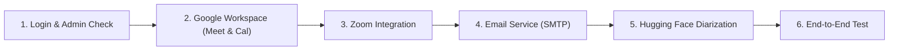

# MeetIntel AI — Beginner-Friendly Integration Setup Guide

Welcome to the **MeetIntel AI** integration setup guide. This document walks you through configuring every service step-by-step with clear screenshots-in-words, exact terminal commands for macOS, provider navigation paths, and troubleshooting tips.

---

## Recommended Setup Order



---

## 1. Authentication & Administrator Account Setup

### Purpose
MeetIntel AI enforces role-based access control and organization tenant isolation. Before setting up integrations, ensure you can log into your workspace as an administrator.

### Verified Existing Accounts
If you haven't reset your database, MeetIntel AI includes these accounts:
- **Administrator**: `admin` / `admin123`
- **Team Lead**: `sarah_lead` / `password123`
- **Engineer**: `alex_eng` / `password123`

### Setting a New Admin Password (macOS Terminal)
If you want to set your own password securely without writing it to files or chat:

```bash
cd "/Users/haricharan/Documents/Milestone 1/AI Powered Audio Processing & Transcription"
.venv/bin/python scripts/admin_recovery.py
```

1. Enter your new chosen password (at least 8 characters).
2. Confirm the password.
3. Open your browser to [http://localhost:8501](http://localhost:8501) and sign in.

---

## 2. Google Workspace Integration (Meet, Drive & Calendar)

### Purpose
- **Google Meet & Drive**: Automatically detects cloud meeting recordings and `.vtt` transcripts stored in your Google Drive without requiring manual uploads.
- **Google Calendar**: Pushes approved action items and deadlines into your Google Calendar as scheduled reminder events.

### Prerequisites
- A free Google account or Google Workspace account.
- Access to [Google Cloud Console](https://console.cloud.google.com/).

### Step-by-Step Google Cloud Configuration

#### Step 2.1: Create a Project
1. Go to [Google Cloud Console](https://console.cloud.google.com/).
2. In the top navigation bar, click the project dropdown and select **New Project**.
3. Project Name: `MeetIntel AI` $\rightarrow$ Click **Create**.
4. Make sure your new project is selected in the top bar.

#### Step 2.2: Enable the Required APIs
1. In the left sidebar, click **APIs & Services > Library**.
2. Search for and enable each of these three APIs:
   - **Google Calendar API**
   - **Google Drive API**
   - **Google Meet API**

#### Step 2.3: Configure the OAuth Consent Screen (Fixes "Access Blocked" Error)
> [!IMPORTANT]
> The error *"Access blocked: MeetIntel AI has not completed the Google verification process"* occurs because Google requires any application in "Testing" mode to explicitly whitelist the email address attempting to log in.

1. In the left sidebar, click **APIs & Services > OAuth consent screen**.
2. Select User Type:
   - If using a personal `@gmail.com`: Select **External** $\rightarrow$ Click **Create**.
   - If using Google Workspace organization: Select **Internal** $\rightarrow$ Click **Create**.
3. **App Information**:
   - App name: `MeetIntel AI`
   - User support email: Select your email.
   - Developer contact email: Enter your email.
   - Click **Save and Continue**.
4. **Scopes**:
   - Click **Add or Remove Scopes**.
   - Search and select:
     - `.../auth/calendar.events` (Manage events on your calendar)
     - `.../auth/drive.readonly` (Read Drive files and recordings)
     - `.../auth/userinfo.email` (See your primary Google Account email)
   - Click **Update** $\rightarrow$ Click **Save and Continue**.
5. **Test Users (CRITICAL STEP)**:
   - Click **+ Add Users**.
   - Enter your personal Google email address (the exact account you will use to log into Google).
   - Click **Add** $\rightarrow$ Click **Save and Continue**.
   - *Result: Your email is now authorized to bypass the Google unverified app screen.*

#### Step 2.4: Create OAuth 2.0 Credentials
1. In the left sidebar, click **APIs & Services > Credentials**.
2. Click **+ Create Credentials > OAuth client ID**.
3. Application type: **Web application**.
4. Name: `MeetIntel Local Client`.
5. Under **Authorized redirect URIs**, click **+ Add URI** and add BOTH:
   - `http://localhost:8000/api/google/oauth/callback`
   - `http://localhost:8501/api/google/oauth/callback`
6. Click **Create**.
7. Copy the **Client ID** and **Client Secret**.

#### Step 2.5: Add Credentials to `.env`
Open `.env` in your project and update:
```env
GOOGLE_CLIENT_ID=your-google-client-id.apps.googleusercontent.com
GOOGLE_CLIENT_SECRET=your-google-client-secret
GOOGLE_REDIRECT_URI=http://localhost:8000/api/google/oauth/callback
```

#### Step 2.6: Test the Connection
1. In MeetIntel AI, go to **Integrations** in the sidebar.
2. Under Google Meet or Google Calendar, click **✦ Authorize Google Workspace**.
3. Google will open in a new tab:
   - Select your whitelisted test user account.
   - If you see *"Google hasn't verified this app"*, click **Advanced** $\rightarrow$ Click **Go to MeetIntel AI (unsafe)**.
   - Check the boxes to grant Calendar and Drive permissions $\rightarrow$ Click **Continue**.
4. You will see a success screen confirming your account is linked and redirecting you back to MeetIntel AI.
5. In the Integrations Center, the card will display:
   - Status: `Connected — Live`
   - Account: Your Google email.

---

## 3. Zoom Meetings Integration

### Purpose
Automatically ingests Zoom cloud recordings when meetings conclude, using webhooks with HMAC-SHA256 signature verification.

### Prerequisites
- A Zoom Pro, Business, or Enterprise account (Zoom requires a paid plan for Cloud Recording API access).
- Developer access to [Zoom App Marketplace](https://marketplace.zoom.us/).

### Step-by-Step Zoom Configuration

#### Step 3.1: Create a Server-to-Server OAuth or General App
1. Go to [Zoom Marketplace](https://marketplace.zoom.us/) and sign in.
2. In the top right, click **Develop > Build App**.
3. Select **Server-to-Server OAuth** (Recommended for automated organizational ingestion) or **General App**.
4. App Name: `MeetIntel AI Connector` $\rightarrow$ Click **Create**.

#### Step 3.2: Configure Scopes
Add the following scopes:
- `recording:read` (View and download meeting recordings)
- `meeting:read` (View meeting details and attendance)

#### Step 3.3: Configure Event Subscriptions (Webhooks)
1. In your app features, toggle **Event Subscriptions** to **ON**.
2. Click **Add Event Subscription**:
   - Subscription Name: `MeetIntel Recording Ingestion`
   - Event notification endpoint URL:
     - *Local testing:* Use an HTTPS tunnel like ngrok (`https://your-tunnel.ngrok-free.app/api/zoom/webhook`).
     - *Production:* `https://your-domain.com/api/zoom/webhook`.
3. Click **+ Add Events**:
   - Under **Recording**, check **All Recordings have completed** (`recording.completed`).
   - Click **Done**.
4. Copy the **Secret Token** provided under the webhook URL.

#### Step 3.4: Configure `.env`
```env
ZOOM_CLIENT_ID=your-zoom-client-id
ZOOM_CLIENT_SECRET=your-zoom-client-secret
ZOOM_WEBHOOK_SECRET=your-zoom-webhook-secret-token
ZOOM_REDIRECT_URI=http://localhost:8000/api/zoom/oauth/callback
```

#### Step 3.5: Testing Zoom
- If you don't have a paid Zoom account, leave Zoom credentials blank or set `DEMO_MODE=true` in `.env`. MeetIntel AI will run the verified **Sandboxed Demo Mode**, which allows you to simulate Zoom recordings without a paid plan.

---

## 4. Email Notification Service (SMTP)

### Purpose
Sends personalized, attendance-aware follow-up briefings to employees who were absent from a meeting, including only their approved assigned tasks and relevant decisions.

### Prerequisites
Any standard SMTP email account. For testing, you can use a personal Gmail account with a free **Gmail App Password**.

### Creating a Free Gmail App Password (2 Minutes)
1. Go to your [Google Account Security Settings](https://myaccount.google.com/security).
2. Enable **2-Step Verification** if not already enabled.
3. In the search bar at the top of the Google Account page, search for **App passwords**.
4. App name: `MeetIntel AI` $\rightarrow$ Click **Create**.
5. Google will generate a 16-character password (e.g., `abcd efgh ijkl mnop`).

### Configure `.env` for Gmail SMTP
```env
SMTP_HOST=smtp.gmail.com
SMTP_PORT=587
SMTP_USER=your-email@gmail.com
SMTP_PASSWORD=abcdefghijklmnop
SMTP_FROM=your-email@gmail.com
```

*(For SendGrid, AWS SES, or Brevo, simply use their host and API key as the password).*

### Testing Email Notifications
1. In MeetIntel AI, go to **Follow-ups & Notifications**.
2. Select any meeting and an absent employee.
3. Review the drafted briefing.
4. Click **Approve & Dispatch**.
5. With credentials configured, the email is dispatched via TLS and recorded in `audit_events`. In Demo Mode, it is simulated locally.

---

## 5. Hugging Face Speaker Diarization

### Purpose
Separates different voices in an audio file so the AI knows who said what (`Speaker 01`, `Speaker 02`).

### Prerequisites
1. Create a free account at [Hugging Face](https://huggingface.co/).
2. Visit the model page: [pyannote/speaker-diarization-community-1](https://huggingface.co/pyannote/speaker-diarization-community-1).
3. Click **Accept conditions / Request access**.
4. Go to **Settings > Access Tokens** $\rightarrow$ Create a token with `read` permission.

### Configure `.env`
```env
HUGGINGFACE_TOKEN=hf_yourHuggingFaceTokenHere
```

---

## 6. Restarting Services After Changing `.env`

Whenever you update your `.env` file, restart your local processes in Terminal:

```bash
# In Terminal Tab 1 (FastAPI Backend):
# Press Ctrl+C to stop, then run:
.venv/bin/uvicorn api.main:app --host 127.0.0.1 --port 8000 --reload

# In Terminal Tab 2 (Streamlit Frontend):
# Press Ctrl+C to stop, then run:
.venv/bin/streamlit run app.py --server.port 8501
```

---

## 7. Verification Checklist

- [ ] **Login**: Able to log in with `admin` / `admin123` at `http://localhost:8501`.
- [ ] **Gemini AI**: `scripts/check_gemini.py` outputs `PASS` for `gemini-3.6-flash`.
- [ ] **Google OAuth**: Whitelisted email in GCP Console Test Users list.
- [ ] **Google Calendar**: Authorized in Integrations Center; shows `Connected — Live`.
- [ ] **Google Meet**: Click "Discover Drive Artifacts" to view discovered files.
- [ ] **Zoom**: Live mode if paid Zoom plan configured; otherwise Sandboxed Demo simulation.
- [ ] **Email**: SMTP configured or simulated in Demo Mode.
