# MeetIntel AI — Master Documentation & Learning Index

Welcome to the official documentation and learning system for **MeetIntel AI — AI-Powered Meeting-to-Execution Platform**.

This documentation suite is organized for beginners, software engineering interns, technical evaluators, and system administrators. Every document is strictly grounded in the verified source code and reproducible test suite of the application.

---

## 1. Recommended Learning Path for Beginners

If you are new to MeetIntel AI or preparing for an evaluation, read the documents in this sequence:

```mermaid
flowchart LR
    Step1["1. Master Index<br>(docs/README.md)"] --> Step2["2. Complete User Manual<br>(MEETINTEL_AI_USER_MANUAL.md)"]
    Step2 --> Step3["3. Practical Tutorials<br>(PRACTICAL_TUTORIALS.md)"]
    Step3 --> Step4["4. Tech Deep-Dive<br>(FEATURES_AND_TECHNOLOGY_EXPLAINED.md)"]
    Step4 --> Step5["5. End-to-End Workflows<br>(END_TO_END_WORKFLOWS.md)"]
    Step5 --> Step6["6. Feature Inventory<br>(FEATURE_INVENTORY.md)"]
    Step6 --> Step7["7. QA Test Checklist<br>(FEATURE_VERIFICATION_CHECKLIST.md)"]
    Step7 --> Step8["8. Viva Guide<br>(PROJECT_PRESENTATION_AND_VIVA.md)"]
```



| Step | Document | Purpose & Who Should Read It |
| :---: | :--- | :--- |
| **1** | [Master Documentation Index](file:///Users/haricharan/Documents/Milestone%201/AI%20Powered%20Audio%20Processing%20&%20Transcription/docs/README.md) | High-level overview, document map, and quick-start instructions. |
| **2** | [Complete User Manual](file:///Users/haricharan/Documents/Milestone%201/AI%20Powered%20Audio%20Processing%20&%20Transcription/docs/MEETINTEL_AI_USER_MANUAL.md) | **Must-Read:** Explains every page, button, form, and card in simple language. |
| **3** | [Step-by-Step Practical Tutorials](file:///Users/haricharan/Documents/Milestone%201/AI%20Powered%20Audio%20Processing%20&%20Transcription/docs/PRACTICAL_TUTORIALS.md) | Hands-on walkthroughs of the 10 major operational workflows. |
| **4** | [Features & Technology Explained](file:///Users/haricharan/Documents/Milestone%201/AI%20Powered%20Audio%20Processing%20&%20Transcription/docs/FEATURES_AND_TECHNOLOGY_EXPLAINED.md) | Deep technical explanations of Faster-Whisper, Pyannote, RAG, ChromaDB, and Fernet AES. |
| **5** | [End-to-End Workflows & Data Flows](file:///Users/haricharan/Documents/Milestone%201/AI%20Powered%20Audio%20Processing%20&%20Transcription/docs/END_TO_END_WORKFLOWS.md) | Traces data lifecycles across frontend, API, database, and cloud providers with Mermaid diagrams. |
| **6** | [Exhaustive Feature Inventory](file:///Users/haricharan/Documents/Milestone%201/AI%20Powered%20Audio%20Processing%20&%20Transcription/docs/FEATURE_INVENTORY.md) | Status matrix of all 62 discovered features, backend routes, models, and limitations. |
| **7** | [Visual Feature & Dependency Map](file:///Users/haricharan/Documents/Milestone%201/AI%20Powered%20Audio%20Processing%20&%20Transcription/docs/FEATURE_MAP.md) | System architecture diagram, service dependencies, and prerequisite chains. |
| **8** | [Feature Verification & QA Checklist](file:///Users/haricharan/Documents/Milestone%201/AI%20Powered%20Audio%20Processing%20&%20Transcription/docs/FEATURE_VERIFICATION_CHECKLIST.md) | 17 manual QA test cases and verified 64-test automated pytest baseline. |
| **9** | [Project Presentation & Viva Guide](file:///Users/haricharan/Documents/Milestone%201/AI%20Powered%20Audio%20Processing%20&%20Transcription/docs/PROJECT_PRESENTATION_AND_VIVA.md) | Evaluation briefing, architecture defenses, and 15 technical viva Q&As. |

---

## 2. Document Descriptions & Cross-References

### 1. [MEETINTEL_AI_USER_MANUAL.md](file:///Users/haricharan/Documents/Milestone%201/AI%20Powered%20Audio%20Processing%20&%20Transcription/docs/MEETINTEL_AI_USER_MANUAL.md)
The primary handbook for operating the MeetIntel AI web application.
- **Section 1:** What is MeetIntel AI, the problem it solves, and beginner's glossary.
- **Section 2:** Signing in, account creation, and role-based permissions (Employee vs. Team Lead vs. Admin).
- **Section 3:** Workspace views (Overview Dashboard, My Commitments, Meeting Library, Process Meeting, 8-Tab Meeting Dossier).
- **Section 4:** Planning & Intelligence (Projects, Decision Register, Pre-Meeting Prep, Knowledge Search).
- **Section 5:** Automation & Ecosystem (Calendar Sync, Follow-ups, Workflow Rules, Integration Center).
- **Section 6:** Governance (Team Directory, AI Quality Center, Audit Trail, Settings).

### 2. [FEATURES_AND_TECHNOLOGY_EXPLAINED.md](file:///Users/haricharan/Documents/Milestone%201/AI%20Powered%20Audio%20Processing%20&%20Transcription/docs/FEATURES_AND_TECHNOLOGY_EXPLAINED.md)
The technical architectural guide explaining how each underlying library is utilized.
- **Conceptual distinctions:** Frontend vs. Backend, Button vs. API Route, Suggestion vs. Fact.
- **Speech Stack:** FFmpeg normalization, Faster-Whisper int8 quantization, Pyannote diarization, alignment.
- **AI Stack:** Multi-provider manager (Gemini/OpenAI/Demo), circuit breaking, Pydantic schema validation.
- **Storage & RAG Stack:** SQLite/PostgreSQL, Sentence-Transformers, ChromaDB vector collections, tenant filtering.
- **Ecosystem Stack:** Google OAuth 2.0, Zoom HMAC-SHA256 signature verification, Fernet AES token encryption.

### 3. [PRACTICAL_TUTORIALS.md](file:///Users/haricharan/Documents/Milestone%201/AI%20Powered%20Audio%20Processing%20&%20Transcription/docs/PRACTICAL_TUTORIALS.md)
10 step-by-step practical exercises using safe, realistic corporate scenarios.
- **Tutorial 1:** First-time setup, logging in, and seeding demo data.
- **Tutorial 2:** Ingesting audio, monitoring the 5-step pipeline, and viewing results.
- **Tutorial 3:** Verifying AI summaries, decisions, and verbatim transcript quotes.
- **Tutorial 4:** Updating deliverable statuses, escalating blockers, and approving tasks.
- **Tutorial 5:** Registering strategic projects and superseding decisions.
- **Tutorial 6:** Grounded Ask AI cross-meeting queries and semantic search.
- **Tutorial 7:** Approving tasks, syncing Google Calendar, and running worker batches.
- **Tutorial 8:** Testing integrations and drafting absent employee follow-ups.
- **Tutorial 9:** Reviewing team accountability, running AI benchmarks, and exporting audit logs.
- **Tutorial 10:** Admin password recovery, handling API rate limits, and database maintenance.

### 4. [END_TO_END_WORKFLOWS.md](file:///Users/haricharan/Documents/Milestone%201/AI%20Powered%20Audio%20Processing%20&%20Transcription/docs/END_TO_END_WORKFLOWS.md)
Deep dive into data lifecycles with source-backed Mermaid diagrams.
- **Workflow A:** Raw audio $\rightarrow$ Validation $\rightarrow$ Faster-Whisper $\rightarrow$ Pyannote $\rightarrow$ LLM $\rightarrow$ Database.
- **Workflow B:** Extracted action item $\rightarrow$ Lead approval $\rightarrow$ Idempotent Calendar Sync $\rightarrow$ Delivery.
- **Workflow C:** Dialogue turns $\rightarrow$ Chunking $\rightarrow$ ChromaDB $\rightarrow$ RAG retrieval $\rightarrow$ Citation chips.
- **Workflow D:** Commitments $\rightarrow$ Strategic project association $\rightarrow$ Milestone velocity tracking.
- **Workflow E:** Absentee detection $\rightarrow$ Personalized drafting $\rightarrow$ Review-before-send gating $\rightarrow$ Acknowledgment.

### 5. [FEATURE_INVENTORY.md](file:///Users/haricharan/Documents/Milestone%201/AI%20Powered%20Audio%20Processing%20&%20Transcription/docs/FEATURE_INVENTORY.md)
Exhaustive catalog of all 62 features discovered across the repository with verification evidence.
- Verified Working: **52 features (83.9%)**
- Configuration Required: **6 features (9.7%)**
- Sandboxed Demo / Mock: **4 features (6.4%)**
- Broken / Unimplemented: **0 features (0.0%)**

### 6. [FEATURE_MAP.md](file:///Users/haricharan/Documents/Milestone%201/AI%20Powered%20Audio%20Processing%20&%20Transcription/docs/FEATURE_MAP.md)
Visual architecture map mapping UI elements to backend handlers, database models, permissions, and prerequisites.

### 7. [FEATURE_VERIFICATION_CHECKLIST.md](file:///Users/haricharan/Documents/Milestone%201/AI%20Powered%20Audio%20Processing%20&%20Transcription/docs/FEATURE_VERIFICATION_CHECKLIST.md)
Quality assurance manual testing checklist covering 17 detailed test cases with expected vs. actual outcome logs.

### 8. [PROJECT_PRESENTATION_AND_VIVA.md](file:///Users/haricharan/Documents/Milestone%201/AI%20Powered%20Audio%20Processing%20&%20Transcription/docs/PROJECT_PRESENTATION_AND_VIVA.md)
Essential guide for project defense, internship reviews, and academic vivas with 15 comprehensive Q&As.

---

## 3. Quick-Start Commands Summary

### Start Streamlit Frontend
```bash
.venv/bin/streamlit run app.py
```
*Access UI at:* `http://localhost:8501`

### Start FastAPI REST Service (Optional)
```bash
.venv/bin/uvicorn api.main:app --host 0.0.0.0 --port 8000 --reload
```
*Access Interactive Swagger Docs at:* `http://localhost:8000/docs`

### Execute Automated Test Suite
```bash
PYTHONPATH=. .venv/bin/pytest tests/
```
*Expected Result:* `64 passed in ~20-26s`

### Execute Admin Recovery CLI
```bash
PYTHONPATH=. .venv/bin/python scripts/admin_recovery.py --username admin --password "YourNewPassword"
```
